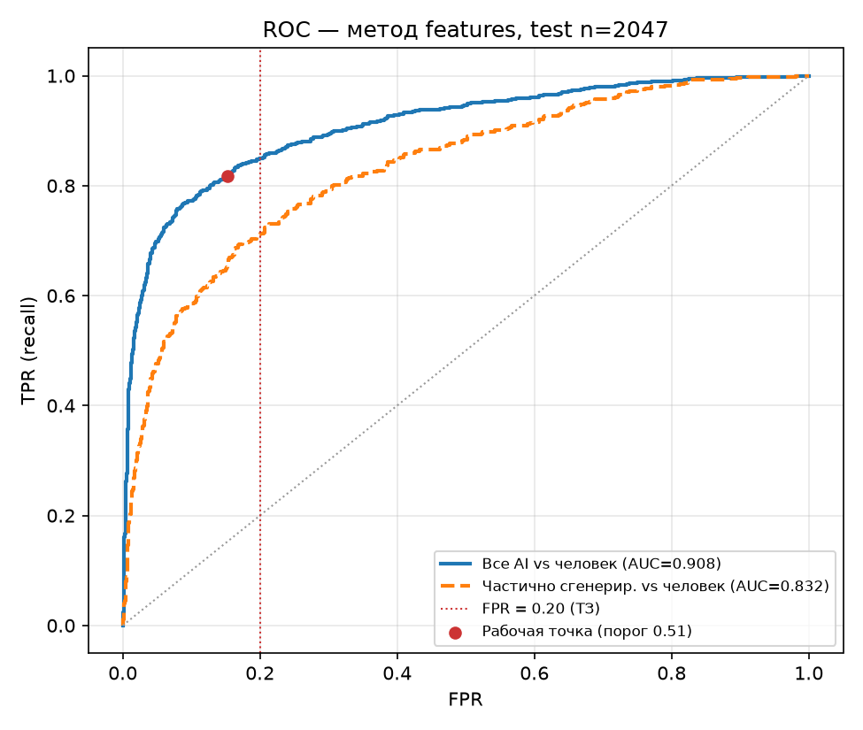

# Отчёт о метриках DW-1 (п. 4.1.11 ТЗ)

Датасет: `v1`; тест: 2047 записей. Пороги подобраны на val, тест для настройки не использовался.

## Метод `features`

| Метрика (табл. 3 ТЗ) | Значение | Требование | Статус |
|---|---:|---:|:---:|
| ROC-AUC по бинарной метке | 0.908 | >= 0.7 | PASS |
| F1-мера на калиброванном пороге | 0.852 | >= 0.7 | PASS |
| FPR на письмах, написанных человеком | 0.153 | <= 0.2 | PASS |
| FPR на легитимных маркетинговых рассылках | 0.010 | <= 0.2 | PASS |
| ROC-AUC: частично сгенерированные vs человек | 0.832 | >= 0.7 | PASS |
| Локализация фрагментов, F1 по символам (частично сгенерированные) | 0.718 | >= 0.6 | PASS |
| Полнота выявления сгенерированных зон | 0.974 | не предъявляется | — |
| Сохранность ROC-AUC при маскировке (минимум по сценариям) | 0.895 | не предъявляется | — |
| Ширина 95% ДИ ROC-AUC (бутстреп, 1000 итераций) | 0.025 | не предъявляется | — |

Precision 0.889, recall 0.817, accuracy 0.829; порог 0.511; 95% ДИ ROC-AUC [0.895; 0.920].

Разрез по языку:

| Язык | n | ROC-AUC | F1 | FPR |
|---|---:|---:|---:|---:|
| en | 1298 | 0.920 | 0.846 | 0.083 |
| ru | 749 | 0.875 | 0.860 | 0.312 |

Разрез по источнику:

| Источник | n | ROC-AUC | F1 | FPR |
|---|---:|---:|---:|---:|
| customer_case | 144 | — | 1.000 | — |
| dw1_generated | 89 | — | 0.764 | — |
| enron_aeslc | 220 | — | 0.000 | 0.018 |
| enron_newsletters | 97 | — | 0.000 | 0.010 |
| llmtrace_detection | 1497 | 0.866 | 0.838 | 0.240 |

Срез «письма, согласованные по теме и эпохе» (Enron человек vs LLM-письма на те же темы): n=406, ROC-AUC 0.881, F1 0.738, FPR 0.016.

Recall на отложенных письмах кейса Заказчика (samples_prompt, кампании не пересекаются с train): 1.000 (n=144).

Recall по способу генерации: external_ai 0.95, external_mixed 0.69, full 0.90, partial_append 0.36, partial_insert 0.15, partial_rewrite 0.00, variation 1.00

Маскировка AI-признаков (ROC-AUC): zero_width 0.908, homoglyphs 0.908, typos 0.895, casual_rewrite 0.905

## Производительность (табл. 2 ТЗ)

- Письма кейса: 300, среднее время анализа одного письма: 0.01 c (требование ≤ 1 c)
- Прогноз на 1000 писем: 10.0 c (требование ≤ 300 c)
- Обучение и калибровка: 57.2 c на CPU (требование ≤ 600 c)
