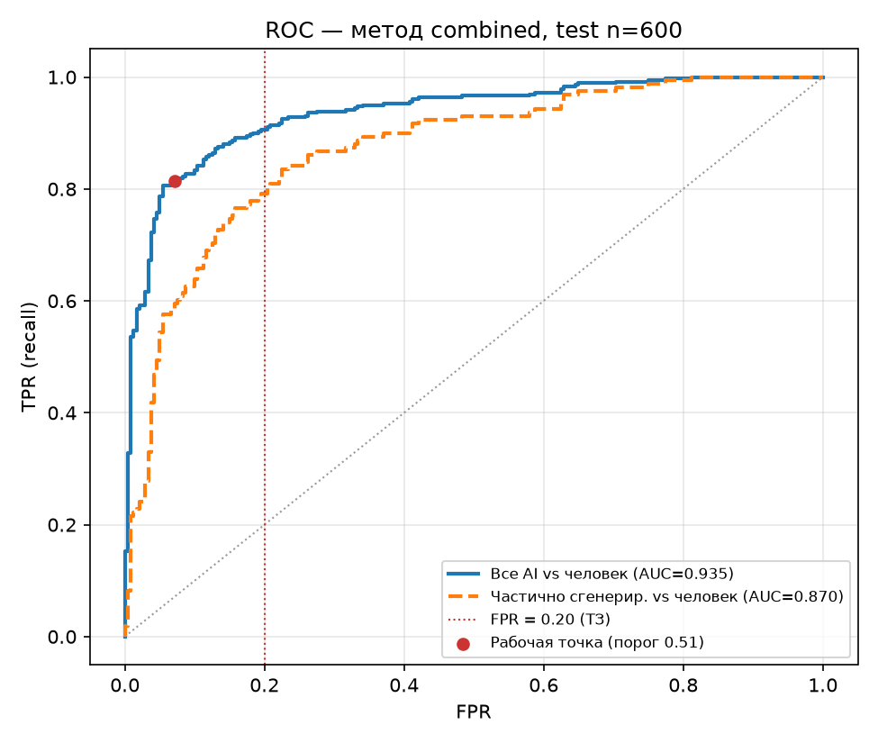

# Отчёт о метриках DW-1 (п. 4.1.11 ТЗ)

Датасет: `v1`; тест: 600 записей. Пороги подобраны на val, тест для настройки не использовался.

## Метод `combined`

| Метрика (табл. 3 ТЗ) | Значение | Требование | Статус |
|---|---:|---:|:---:|
| ROC-AUC по бинарной метке | 0.935 | >= 0.7 | PASS |
| F1-мера на калиброванном пороге | 0.875 | >= 0.7 | PASS |
| FPR на письмах, написанных человеком | 0.071 | <= 0.2 | PASS |
| FPR на легитимных маркетинговых рассылках | 0.000 | <= 0.2 | PASS |
| ROC-AUC: частично сгенерированные vs человек | 0.870 | >= 0.7 | PASS |
| Локализация фрагментов, F1 по символам (частично сгенерированные) | 0.824 | >= 0.6 | PASS |
| Полнота выявления сгенерированных зон | 0.972 | не предъявляется | — |
| Сохранность ROC-AUC при маскировке (минимум по сценариям) | 0.896 | не предъявляется | — |
| Ширина 95% ДИ ROC-AUC (бутстреп, 1000 итераций) | 0.039 | не предъявляется | — |

Precision 0.945, recall 0.814, accuracy 0.860; порог 0.511; 95% ДИ ROC-AUC [0.916; 0.955].

Разрез по языку:

| Язык | n | ROC-AUC | F1 | FPR |
|---|---:|---:|---:|---:|
| en | 400 | 0.943 | 0.863 | 0.029 |
| ru | 200 | 0.918 | 0.893 | 0.179 |

Разрез по источнику:

| Источник | n | ROC-AUC | F1 | FPR |
|---|---:|---:|---:|---:|
| customer_case | 41 | — | 1.000 | — |
| dw1_generated | 32 | — | 0.792 | — |
| enron_aeslc | 66 | — | 0.000 | 0.000 |
| enron_newsletters | 29 | — | 0.000 | 0.000 |
| llmtrace_detection | 432 | 0.918 | 0.864 | 0.117 |

Срез «письма, согласованные по теме и эпохе» (Enron человек vs LLM-письма на те же темы): n=127, ROC-AUC 0.892, F1 0.792, FPR 0.000.

Recall на отложенных письмах кейса Заказчика (samples_prompt, кампании не пересекаются с train): 1.000 (n=41).

Recall по способу генерации: external_ai 0.99, external_mixed 0.63, full 0.95, partial_append 0.20, partial_insert 0.00, partial_rewrite 0.00

Маскировка AI-признаков (ROC-AUC): zero_width 0.928, homoglyphs 0.896, typos 0.896, casual_rewrite 0.934

