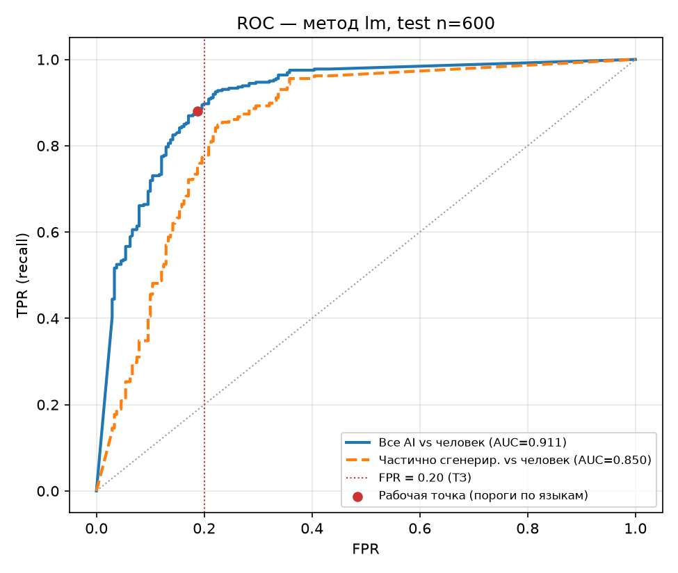

# Отчёт о метриках DW-1 (п. 4.1.11 ТЗ)

Датасет: `v1`; тест: 600 записей. Пороги подобраны на val, тест для настройки не использовался.

## Метод `lm`

| Метрика (табл. 3 ТЗ) | Значение | Требование | Статус |
|---|---:|---:|:---:|
| ROC-AUC по бинарной метке | 0.911 | >= 0.7 | PASS |
| F1-мера на калиброванном пороге | 0.878 | >= 0.7 | PASS |
| FPR на письмах, написанных человеком | 0.188 | <= 0.2 | PASS |
| FPR на легитимных маркетинговых рассылках | 0.241 | <= 0.2 | **FAIL** |
| ROC-AUC: частично сгенерированные vs человек | 0.850 | >= 0.7 | PASS |
| Локализация фрагментов, F1 по символам (частично сгенерированные) | 0.838 | >= 0.6 | PASS |
| Полнота выявления сгенерированных зон | 0.961 | не предъявляется | — |
| Сохранность ROC-AUC при маскировке (минимум по сценариям) | 0.807 | не предъявляется | — |
| Ширина 95% ДИ ROC-AUC (бутстреп, 1000 итераций) | 0.049 | не предъявляется | — |

Precision 0.876, recall 0.881, accuracy 0.853; пороги {'en': 0.2727, 'ru': 0.3836}; 95% ДИ ROC-AUC [0.887; 0.936].

Разрез по языку:

| Язык | n | ROC-AUC | F1 | FPR |
|---|---:|---:|---:|---:|
| en | 400 | 0.918 | 0.885 | 0.173 |
| ru | 200 | 0.887 | 0.866 | 0.224 |

Разрез по источнику:

| Источник | n | ROC-AUC | F1 | FPR |
|---|---:|---:|---:|---:|
| customer_case | 41 | — | 1.000 | — |
| dw1_generated | 32 | — | 0.897 | — |
| enron_aeslc | 66 | — | 0.000 | 0.197 |
| enron_newsletters | 29 | — | 0.000 | 0.241 |
| llmtrace_detection | 432 | 0.910 | 0.890 | 0.172 |

Срез «письма, согласованные по теме и эпохе» (Enron человек vs LLM-письма на те же темы): n=127, ROC-AUC 0.870, F1 0.667, FPR 0.211.

Recall на отложенных письмах кейса Заказчика (samples_prompt, кампании не пересекаются с train): 1.000 (n=41).

Recall по способу генерации: external_ai 0.98, external_mixed 0.77, full 1.00, partial_append 0.40, partial_insert 0.25, partial_rewrite 1.00

Маскировка AI-признаков (ROC-AUC): zero_width 0.887, homoglyphs 0.807, typos 0.835, casual_rewrite 0.906

